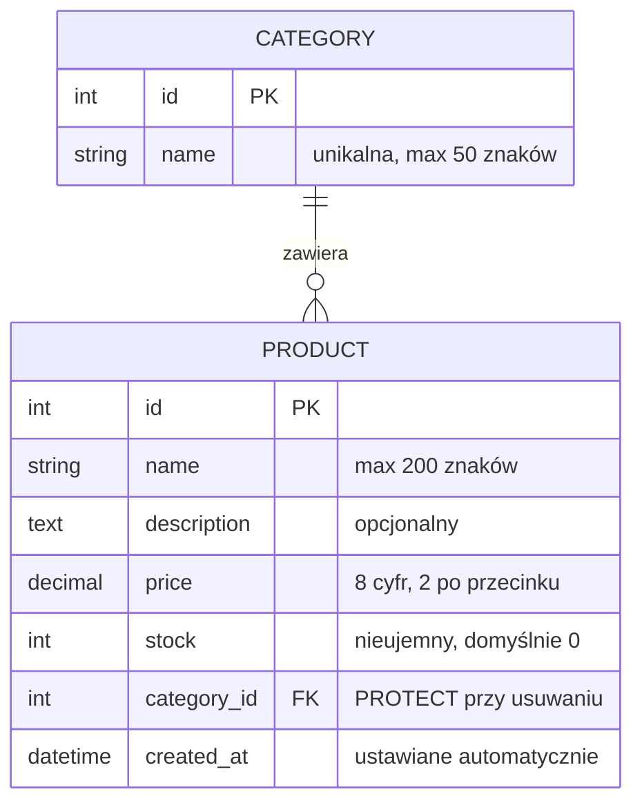
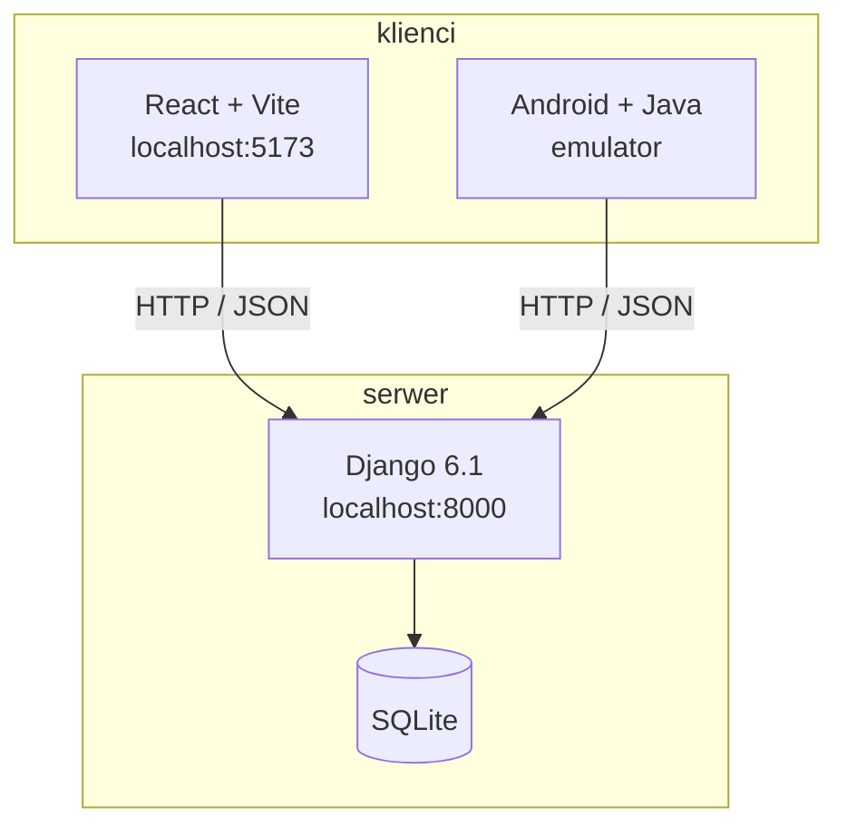
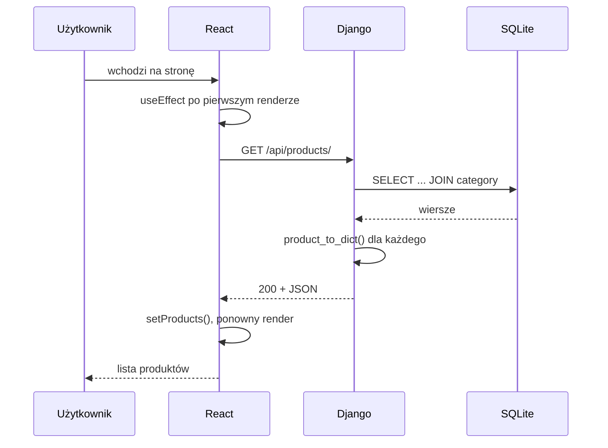

# Dokumentacja projektu

**Technik programista | klasa 5 | materiał 11**

---

## Zacznij od testu

Wyobraź sobie, że dziś wieczorem ktoś obcy – kolega z innej klasy, rekruter, egzaminator –
dostaje odsyłacz do Twojego repozytorium. Nic więcej. Żadnej rozmowy, żadnego „a tutaj
musisz jeszcze…".

Odpowiedz szczerze:

1. Czy w ciągu pięciu minut zrozumie, **co ta aplikacja robi**?
2. Czy uruchomi backend, frontend i mobilkę, korzystając **tylko** z tego, co napisane?
3. Czy dowie się, jakie endpointy istnieją i co zwracają, **bez czytania kodu**?
4. Czy zobaczy, **jak te trzy części się ze sobą łączą**?

Jeśli choć raz odpowiedziałeś „nie" – ten materiał jest o tym.

W materiale 10 opisywałeś projekt **od środka**, dla kogoś, kto będzie zmieniał Twój kod.
Teraz opisujesz go **od zewnątrz**, dla kogoś, kto Twojego kodu wcale nie chce czytać.

---

## Czterech czytelników

Dokumentacja projektu nie jest jednym dokumentem. To zestaw, bo czytelnicy mają różne
potrzeby i różną cierpliwość.

| Czytelnik | Pytanie | Dokument |
|---|---|---|
| Ktoś, kto chce **uruchomić** | „jak to odpalić?" | `README.md` – instrukcja instalacji |
| Ktoś, kto chce **użyć API** | „jakie są endpointy?" | `docs/api.md` |
| Ktoś, kto chce **zrozumieć** | „jak to działa i czemu tak?" | `docs/architektura.md`, `docs/baza-danych.md` |
| Ktoś, kto chce **skorzystać z aplikacji** | „jak dodać produkt?" | `docs/instrukcja.md` |

Do tego piąty, o którym łatwo zapomnieć: **Ty w styczniu**, trzy dni przed egzaminem,
powtarzający materiał z własnego projektu. Dobrze napisana dokumentacja jest wtedy
najlepszą możliwą ściągą – bo opisuje działający system Twoimi słowami.

---

## Krok 1 – porządki w `docs/`

Zacznij od sprzątania, bo przez dziesięć materiałów nazbierało się tam bałaganu.
Prawdopodobnie masz coś takiego:

```
docs/
├── cors.md
├── react.md
├── android.md
├── orm.md
├── kontrakt.md
├── dokumentacja.md
└── baza.md
```

To są **notatki z nauki** – zapisy ćwiczeń, zrzuty ekranu, odpowiedzi na pytania
z zadań. Są wartościowe, ale **nie są dokumentacją projektu**. Nikt obcy nie chce
czytać, czego się uczyłeś; chce wiedzieć, jak działa system.

Rozdziel te dwie rzeczy:

```
docs/
├── api.md               ← dokumentacja projektu
├── architektura.md      ←
├── baza-danych.md       ←
├── instrukcja.md        ←
├── zrzuty/              ←
└── notatki/             ← wszystko, co było z zadań
    ├── cors.md
    ├── react.md
    └── ...
```

```bash
mkdir docs/notatki
git mv docs/cors.md docs/react.md docs/android.md docs/orm.md docs/notatki/
```

`git mv` zamiast zwykłego przenoszenia – Git zapamięta, że to ten sam plik, i historia
zmian zostanie zachowana.

Ta decyzja wygląda na kosmetyczną, a nie jest. **Dokumentacja, w której trzeba szukać,
nie jest czytana.** Jeśli obok opisu API leży plik z Twoimi notatkami o wyścigu żądań,
czytelnik nie wie, co jest dla niego.

---

## Krok 2 – README jako wizytówka

README to **jedyny dokument, który ktoś przeczyta na pewno**. GitHub wyświetla go pod
listą plików, więc jest pierwszą i często ostatnią rzeczą, jaką widzi odwiedzający.

Masz go już od materiału 04, rozbudowywany w 06, 07 i 09. Teraz doprowadzasz go do
porządku.

### Co musi być, w tej kolejności

```markdown
# Nazwa projektu

Jedno–dwa zdania: co to jest i dla kogo.

## Co to robi

Trzy–pięć zdań albo lista funkcji. Bez technologii, bez instalacji.
Czytelnik ma zdecydować, czy to go w ogóle interesuje.

## Zrzuty ekranu

Dwa–trzy obrazki. Działają lepiej niż akapit opisu.

## Technologie

Tabela: warstwa, technologia, wersja.

## Architektura

Diagram i dwa zdania. Szczegóły w docs/architektura.md.

## Wymagania

Python 3.14, Node 24, Android Studio. Z numerami wersji.

## Uruchomienie

Krok po kroku, komendy do skopiowania, osobno dla każdej części.

## Zmienne środowiskowe

Tabele dla backendu i frontendu.

## Dokumentacja

Odsyłacze do plików w docs/.

## Autor
```

### Zasada pierwszego ekranu

To, co widać bez przewijania, decyduje o tym, czy ktoś przewinie dalej. Dlatego
**„co to robi" jest przed „jak to zainstalować"**, a nie odwrotnie.

Najczęstszy błąd uczniowskich README: zaczynają się od `pip install -r requirements.txt`.
Czytelnik nie wie jeszcze, czy chce to instalować.

### Uruchomienie: trzy części, trzy bloki

Twój projekt ma teraz trzy uruchamialne elementy i **kolejność ma znaczenie** – frontend
i mobilka bez backendu pokażą tylko komunikat o błędzie. Napisz to wprost:

```markdown
## Uruchomienie

Backend musi działać jako pierwszy – frontend i aplikacja mobilna
pobierają z niego dane.

### 1. Backend (terminal 1)

cd backend
python -m venv venv
venv\Scripts\activate
pip install -r requirements.txt
copy .env.example .env          # uzupełnij SECRET_KEY
python manage.py migrate
python manage.py loaddata initial_data
python manage.py createsuperuser
python manage.py runserver

Działa pod http://localhost:8000
Panel administratora: http://localhost:8000/admin/

### 2. Frontend (terminal 2)

cd frontend
npm install
copy .env.example .env

npm run dev

Działa pod http://localhost:5173

### 3. Aplikacja mobilna

Otwórz katalog android/ w Android Studio i uruchom na emulatorze.

Backend musi nasłuchiwać na wszystkich interfejsach:

cd backend
python manage.py runserver 0.0.0.0:8000

Adres API w ApiClient.java:
- emulator: http://10.0.2.2:8000/api/
- telefon w tej samej sieci: http://ADRES_IP_KOMPUTERA:8000/api/

Adres IP komputera musi być dopisany do ALLOWED_HOSTS w backend/.env.
```

Każda komenda ma być **do skopiowania i wklejenia**. Żadnych „zainstaluj zależności" –
dokładna komenda. Żadnych „uzupełnij konfigurację" – która zmienna i czym.

---

## Krok 3 – diagramy, których nie rysuje się w programie graficznym

W materiale 04 wstawiłem do README odsyłacz do `docs/erd.png`. Czas go zrobić – ale
nie w programie graficznym.

### Mermaid

GitHub renderuje diagramy **Mermaid** wprost w plikach Markdown. Piszesz je jak kod,
w bloku z nazwą języka `mermaid`, a GitHub zamienia je w obrazek.

Dlaczego to jest lepsze niż wyeksportowany PNG:

| | Obrazek PNG | Mermaid |
|---|---|---|
| Poprawka po zmianie modelu | rysujesz od nowa | zmieniasz jedną linię |
| `git diff` | „plik binarny się zmienił" | widać dokładnie co |
| Rozmiar w repozytorium | setki kilobajtów | kilkaset bajtów |
| Edycja przez kogoś innego | musi mieć ten sam program | wystarczy edytor tekstu |

To jest **dokumentacja jako kod** – ta sama idea co migracje zamiast ręcznego SQL-a.
Diagram, który trzeba przerysowywać, nie będzie aktualizowany. Diagram, który jest
tekstem, zmienia się w tym samym commicie co model.

### Diagram bazy danych

W `docs/baza-danych.md`:

````markdown

````

Zapis `||--o{` oznacza relację jeden-do-wielu: jedna kategoria, wiele produktów.
`PK` to klucz główny, `FK` – klucz obcy.

Pod diagramem dopisz tabelę z uzasadnieniem typów – to masz już z zadania 2
w materiale 04:

```markdown
| Pole | Typ Django | Typ w SQL | Dlaczego |
|---|---|---|---|
| `price` | `DecimalField` | `decimal(8,2)` | Float traci dokładność przy sumowaniu |
| `stock` | `PositiveIntegerField` | `integer unsigned` | baza nie przyjmie liczby ujemnej |
| `created_at` | `DateTimeField` | `datetime` | `auto_now_add` ustawia przy tworzeniu |
```

### Diagram architektury

W `docs/architektura.md`:

````markdown

````

Pod diagramem dwa–trzy akapity odpowiadające na pytanie **dlaczego tak**, a nie tylko
jak. Na przykład: że backend wystawia dane, a nie strony HTML, dzięki czemu ten sam
serwer obsługuje oba klienty bez żadnej zmiany; że dodanie trzeciego klienta nie
wymagałoby pracy po stronie serwera.

To jest najcenniejszy fragment całej Twojej dokumentacji, bo pokazuje **zrozumienie**,
a nie wykonanie. Kod pokazuje, że umiesz. Ten akapit pokazuje, że wiesz, po co.

### Diagram przepływu żądania

Jeden diagram, który tłumaczy więcej niż strona tekstu – droga od kliknięcia do
wyświetlenia:

````markdown

````

Zwróć uwagę, że ten diagram zawiera nazwy **Twoich** funkcji. Diagram ogólny, przepisany
z internetu, nie dokumentuje niczego.

### Gdy potrzebny jest obrazek

Mermaid renderuje się na GitHubie i w podglądzie Markdown w VS Code. **Nie wyrenderuje
się** w pliku PDF, w dokumencie Word ani w wydruku – a na egzaminie może być potrzebny
obrazek.

Rozwiązanie: źródło trzymasz w Mermaid, a obrazek **eksportujesz, gdy jest potrzebny**.
Wejdź na `mermaid.live`, wklej kod diagramu i pobierz PNG albo SVG. Źródło zostaje
wersjonowane, obrazek jest produktem ubocznym – dokładnie tak jak `dist/` i wygenerowany
Javadoc.

---

## Krok 4 – dokumentacja API

Najbardziej konkretny dokument w całym zestawie. Ktoś, kto chce napisać kolejnego
klienta Twojego API, potrzebuje dokładnie tego – i niczego więcej.

W `docs/api.md`:

```markdown
# API – opis endpointów

Adres bazowy: `http://localhost:8000/api/`
Format żądań i odpowiedzi: JSON
Uwierzytelnianie: brak – API jest publiczne
Obsługiwane metody: wyłącznie GET

## Spis endpointów

| Metoda | Ścieżka | Opis |
|---|---|---|
| GET | `/health/` | stan usługi i połączenia z bazą |
| GET | `/info/` | wersje, źródło danych, czas działania |
| GET | `/products/` | lista produktów |
| GET | `/products/?category=<nazwa>` | lista filtrowana |
| GET | `/products/<id>/` | pojedynczy produkt |

---

## GET /products/

Zwraca wszystkie produkty, posortowane po nazwie.

### Parametry

| Nazwa | Typ | Wymagany | Opis |
|---|---|---|---|
| `category` | tekst | nie | nazwa kategorii; pominięcie zwraca wszystkie |

### Przykładowe żądanie

    curl http://localhost:8000/api/products/?category=peripherals

### Odpowiedź 200 OK

    [
      {
        "id": 1,
        "name": "Klawiatura mechaniczna K80",
        "description": "Przełączniki brązowe, układ TKL.",
        "price": "349.00",
        "stock": 12,
        "category": "peripherals",
        "created_at": "2026-09-01T09:12:44.812000+00:00"
      }
    ]

### Uwagi

- `price` jest **tekstem**, nie liczbą – pole w bazie jest typu `Decimal`,
  a konwersja na liczbę zmiennoprzecinkową psułaby dokładność. Klient zamienia
  je na liczbę u siebie.
- `category` to nazwa kategorii, nie obiekt.
- `created_at` jest w formacie ISO 8601, w strefie UTC.
- Brak wyników to **pusta tablica ze statusem 200**, nie 404 – zapytanie było
  poprawne, po prostu nic nie pasuje.

---

## GET /products/<id>/

### Odpowiedź 404 Not Found

    {"error": "Product 999 not found"}

---

## Kody odpowiedzi

| Kod | Kiedy |
|---|---|
| 200 | poprawny odczyt |
| 404 | zasób o podanym identyfikatorze nie istnieje |
| 500 | błąd po stronie serwera |
| 503 | usługa działa, ale nie ma połączenia z bazą (`/health/`) |
```

### Trzy zasady dobrej dokumentacji API

**Przykłady są ważniejsze od opisów.** Jedna prawdziwa odpowiedź JSON mówi więcej niż
tabela pól. Skopiuj ją ze swojego działającego API – nie przepisuj z pamięci, bo się
pomylisz.

**Opisz dziwactwa.** To, że cena jest tekstem, jest zaskakujące. Jeśli tego nie napiszesz,
każdy kolejny klient zacznie od błędu. Dokumentacja istnieje głównie dla rzeczy, które
nie są oczywiste.

**Opisz też błędy.** Dokumentacja pokazująca tylko udane odpowiedzi jest w połowie
bezużyteczna, bo programista piszący klienta musi wiedzieć, na co się przygotować.

---

## Krok 5 – instrukcja użytkownika

Dotąd wszystko było dla programistów. Teraz dokument dla kogoś, kto **nie wie i nie chce
wiedzieć**, czym jest endpoint.

Twoja aplikacja ma dwóch takich użytkowników: osobę przeglądającą katalog i osobę
zarządzającą danymi w panelu administratora.

W `docs/instrukcja.md`:

```markdown
# Instrukcja użytkownika

## Przeglądanie katalogu

### Wyszukiwanie produktu

1. Wpisz fragment nazwy w pole u góry strony.
2. Lista zawęża się w trakcie pisania – nie trzeba nic zatwierdzać.
3. Aby wrócić do pełnej listy, wyczyść pole.


### Filtrowanie po kategorii

...

## Zarządzanie produktami (panel administratora)

### Dodanie produktu

1. Wejdź na http://localhost:8000/admin/ i zaloguj się.
2. Wybierz **Produkty** → **Dodaj produkt**.
3. Wypełnij pola. Cenę podaj z kropką, na przykład `349.00`.
4. Kategoria jest wymagana – jeśli nie ma odpowiedniej, utwórz ją najpierw
   w sekcji **Kategorie**.
5. Kliknij **Zapisz**.

### Usunięcie kategorii

Kategorii, w której są produkty, **nie da się usunąć** – jest to zabezpieczenie
przed przypadkową utratą danych. Najpierw przenieś produkty do innej kategorii.
```

### Czym ten dokument różni się od poprzednich

**Czynnościami, nie funkcjami.** Nagłówek brzmi „Dodanie produktu", nie „Formularz
produktu". Użytkownik przychodzi z zadaniem, nie z ciekawością.

**Bez nazw technicznych.** Nie „endpoint", nie „model", nie „`PositiveIntegerField`".
Jeśli jakiegoś słowa nie usłyszałby w normalnej rozmowie, zamień je.

**Numerowane kroki i zrzuty ekranu.** To jedyny dokument w całym zestawie, w którym
obrazki są naprawdę niezbędne.

**Opis ograniczeń jako zachowania, nie jako błędu.** „Nie da się usunąć kategorii
z produktami, bo to zabezpieczenie" zamiast „`on_delete=PROTECT` blokuje operację".

---

## Krok 6 – zrzuty ekranu

Trzy–pięć obrazków, w `docs/zrzuty/`.

Co warto pokazać: listę produktów w przeglądarce, ekran szczegółów, tę samą listę
w aplikacji mobilnej, panel administratora, odpowiedź JSON w narzędziu do testowania
żądań.

Zasady, które robią różnicę między zrzutem użytecznym i bezwartościowym:

- **Nazwy plików opisowe**, nie `zrzut1.png`. `lista-produktow-web.png` da się znaleźć
  po pół roku.
- **Przytnij do istoty.** Nie cały pulpit z paskiem zadań i dwudziestoma kartami
  przeglądarki.
- **Prawdziwe dane**, nie „asdf" i „test test". Zrzut z „produkt1, produkt2" wygląda
  na niedokończony projekt.
- **PNG, nie JPG.** Zrzuty ekranu mają tekst i ostre krawędzie; JPG je rozmazuje.
- **Rozsądny rozmiar.** Repozytorium nie jest galerią – jeśli plik ma 4 MB, zmniejsz go.

W Markdown wstawia się je ścieżką względną:

```markdown

```

Tekst w nawiasach kwadratowych to opis alternatywny – wyświetli się, gdy obrazek się nie
wczyta, i przeczyta go czytnik ekranu osobie niewidzącej. To nie jest formalność.

---

## Krok 7 – historia zmian

`CHANGELOG.md` w katalogu głównym. Krótki, odwrotnie chronologiczny.

```markdown
# Historia zmian

## [0.3.0] – 2026-10-20
### Dodane
- Aplikacja mobilna na Androida (Java, Retrofit)
- Endpoint informacyjny zwraca listę kategorii

### Zmienione
- Konfiguracja przeniesiona do plików .env

## [0.2.0] – 2026-10-06
### Dodane
- Modele Category i Product, baza SQLite
- Panel administratora
- Obsługa CORS dla frontendu

### Usunięte
- Dane statyczne w shop/data.py

## [0.1.0] – 2026-09-22
### Dodane
- Pierwsze API: endpointy GET na danych w pamięci
```

Numeracja jest ta sama co w materiale 01: `GŁÓWNA.MNIEJSZA.POPRAWKA`. Numer wersji
w `/api/info/` powinien się z tym zgadzać – to drobiazg, który ktoś sprawdzi.

Po co to, skoro historia jest w Gicie? Bo `git log` ma sto wpisów technicznych,
a `CHANGELOG` dziesięć zdań po polsku. Jedno jest dla programisty szukającego konkretnej
zmiany, drugie dla człowieka pytającego „co nowego".

---

## Krok 8 – dokumentacja na egzaminie

Na części praktycznej INF.04 przygotowanie dokumentacji jest **częścią zadania**, nie
dodatkiem. I jest punktowane.

Dokładne wymagania są zapisane **w treści zadania egzaminacyjnego**: jakie pliki,
w jakich katalogach, pod jakimi nazwami, jakie zrzuty ekranu. Dlatego najważniejsza
umiejętność nie jest techniczna:

> **Przeczytaj wymagania. Zrób dokładnie to, co napisane. Nazwij pliki dokładnie tak,
> jak kazano.**

Brzmi banalnie i jest najczęstszym powodem traconych punktów. Jeśli zadanie mówi
`zrzut_1.png` w katalogu `egzamin`, to nie ma być `Zrzut1.PNG` na pulpicie. Oceniający
sprawdza według listy – plik o innej nazwie po prostu nie istnieje.

Co z tego materiału przenosi się na egzamin bezpośrednio:

- **Nawyk zrzutów ekranu.** Robienie ich w trakcie pracy, nie na końcu, gdy zostało
  siedem minut.
- **Opis struktury bazy.** Jeśli potrafisz go napisać dla swojego projektu, napiszesz
  w cztery minuty dla dowolnego zadania.
- **Opis endpointów albo funkcji.** To samo.
- **Czytelne nazwy plików i katalogów.** Odruch, nie decyzja.

Czego **nie** przenosi: Mermaid, `CHANGELOG`, strony generowane z docstringów. Na
egzaminie nie ma czasu ani internetu. To jest wiedza zawodowa, nie egzaminacyjna – i tak
samo ważna, tylko w innym momencie życia.

> Przed egzaminem sprawdź aktualny informator CKE dla INF.04 – wymagania dotyczące
> rezultatów bywają doprecyzowywane.

---

## Krok 9 – test czystego klona

Teraz weryfikacja. Nie „czy napisałem", ale **czy to działa**.

```bash
cd C:\test
git clone https://github.com/TWOJ_LOGIN/sklep-fullstack.git
cd sklep-fullstack
```

Od tej chwili obowiązuje jedna reguła: **wolno Ci patrzeć wyłącznie w dokumentację**.
Nie w kod. Nie w materiały z zajęć. Nie w pamięć.

Uruchom po kolei backend, frontend i mobilkę. Przy każdym miejscu, w którym musiałeś się
czegoś domyślić, zajrzeć w kod albo przypomnieć sobie, zapisz jedną linię:
**czego brakowało**.

Typowe rzeczy, które wychodzą dopiero przy tym teście:

- brak `loaddata`, więc aplikacja działa i jest pusta;
- brak informacji, że `SECRET_KEY` trzeba sobie wygenerować albo skąd go wziąć;
- brak `createsuperuser`, więc nie da się wejść do panelu;
- adres `10.0.2.2` wpisany w kodzie i nieopisany nigdzie;
- brak wzmianki, że backend musi działać przed frontendem;
- komenda `venv\Scripts\activate` tylko w wersji dla Windowsa, bez wariantu dla Linuksa;
- `npm run dev` bez podanego adresu, pod którym to startuje.

Napraw dokumentację i **powtórz test na świeżym klonie**. Dwa razy, trzy razy, aż
przejdzie bez zacięcia.

To jest moment, w którym dokumentacja przestaje być tekstem o projekcie i staje się
częścią projektu.

---

## Docelowa struktura

```
sklep-fullstack/
├── README.md                    ← wizytówka i uruchomienie
├── CHANGELOG.md                 ← historia wersji
├── .gitignore
├── docs/
│   ├── api.md                   ← opis endpointów
│   ├── architektura.md          ← diagramy i uzasadnienie
│   ├── baza-danych.md           ← ERD i opis pól
│   ├── instrukcja.md            ← dla użytkownika
│   ├── zrzuty/
│   └── notatki/                 ← materiały z nauki
├── backend/
│   ├── .env.example
│   └── requirements.txt
├── frontend/
│   └── .env.example
└── android/
```

Siedem plików dokumentacji. To nie jest dużo – i każdy z nich odpowiada na pytanie
konkretnego czytelnika.

---

## Sprawdź, czy rozumiesz

1. Czym dokumentacja projektu różni się od dokumentacji w kodzie?
2. Dlaczego „co to robi" stoi w README przed instrukcją instalacji?
3. Dlaczego notatki z zajęć nie powinny leżeć obok opisu API?
4. Jakie trzy zalety ma diagram w Mermaid nad wyeksportowanym obrazkiem?
5. Dlaczego w dokumentacji API opisujemy też odpowiedzi błędne?
6. Czym różni się instrukcja użytkownika od opisu API – poza odbiorcą?
7. Po co `CHANGELOG`, jeśli cała historia jest w Gicie?
8. Co jest najważniejszą umiejętnością przy dokumentacji na egzaminie?
9. Dlaczego test czystego klona trzeba zrobić na nowym katalogu, a nie na swoim?
10. Dlaczego wyeksportowany PNG diagramu nie powinien być jedynym jego źródłem?

---

## Częste błędy

| Objaw | Przyczyna |
|---|---|
| README zaczyna się od komend instalacji | brak sekcji „co to robi" |
| kolega nie uruchomił projektu | brak kroku `loaddata`, `.env` albo `createsuperuser` |
| diagram Mermaid nie renderuje się na GitHubie | brak słowa `mermaid` po trzech apostrofach |
| obrazki nie wyświetlają się na GitHubie | ścieżka bezwzględna albo zła wielkość liter w nazwie |
| przykład JSON w dokumentacji nie zgadza się z API | przepisany z pamięci, nie skopiowany |
| dokumentacja opisuje funkcje, których nie ma | pisana „na przyszłość", nie z kodu |
| instrukcja użytkownika zawiera słowo „endpoint" | pisana dla programisty, nie użytkownika |
| repozytorium waży 200 MB | nieprzycięte zrzuty ekranu albo `build/` w repo |
| wersja w `/api/info/` inna niż w `CHANGELOG` | brak aktualizacji przy wydaniu |

---

## Czego jeszcze nie ma

- **Automatycznej dokumentacji API.** Django REST Framework generuje przeglądalny opis
  endpointów z kodu – wtedy `docs/api.md` przestanie wymagać ręcznej aktualizacji.
  Ręczna wersja, którą dziś piszesz, nauczy Cię, **co** taki generator właściwie robi.
- **Testów.** Są formą dokumentacji, która nie potrafi skłamać: gdy kod przestaje
  odpowiadać opisowi, test przestaje przechodzić. Żaden plik `.md` tego nie zrobi.
- **Dokumentacji wdrożenia.** Jak uruchomić to na serwerze, a nie na swoim komputerze.

---

## Co dalej

Zamyka się etap dokumentowania. Projekt ma trzy działające części, opisane od środka
i od zewnątrz.

Dalej wchodzi **zapis**: Django REST Framework w miejsce ręcznej serializacji, potem
metody POST, PUT i DELETE z walidacją danych wejściowych, a na końcu logowanie. Wtedy
dokumentacja API zacznie się generować sama – a Ty będziesz jedną z niewielu osób, które
wiedzą, co tam pod spodem powstaje.

---

# Zadania

**Zadanie 1 – porządki**
Rozdziel `docs/` na dokumentację projektu i `docs/notatki/`. Użyj `git mv`, żeby
zachować historię. Commit.

**Zadanie 2 – README**
Pełne README według układu z tego materiału. Obowiązkowo sekcja „co to robi" **przed**
instalacją, tabela technologii z wersjami i instrukcja uruchomienia osobno dla trzech
części, z zaznaczoną kolejnością.

**Zadanie 3 – diagram bazy danych**
`docs/baza-danych.md` z diagramem Mermaid `erDiagram` dla Twoich modeli plus tabelą
uzasadnienia typów. Sprawdź na GitHubie, że diagram się renderuje – zrzut ekranu
do `docs/notatki/`.

**Zadanie 4 – architektura**
`docs/architektura.md` z diagramem `flowchart` Twojego systemu. Pod diagramem
**minimum trzy akapity** odpowiadające na pytanie, dlaczego backend wystawia dane,
a nie strony HTML, i co trzeba byłoby zrobić inaczej, gdyby generował HTML.

**Zadanie 5 – przepływ żądania**
Diagram `sequenceDiagram` pokazujący drogę od akcji użytkownika do wyświetlenia danych,
z nazwami **Twoich** funkcji i endpointów. Nie ogólny – Twój.

**Zadanie 6 – dokumentacja API**
`docs/api.md` ze wszystkimi endpointami: tabela zbiorcza, potem sekcja dla każdego
z parametrami, przykładowym żądaniem i **odpowiedzią skopiowaną z działającego API**.
Obowiązkowo sekcja o kodach odpowiedzi i o dziwactwach formatu.

**Zadanie 7 – instrukcja użytkownika**
`docs/instrukcja.md` dla osoby nietechnicznej: minimum cztery czynności, numerowane
kroki, zrzuty ekranu. Zero słów technicznych – sprawdź to, czytając tekst na głos.

**Zadanie 8 – zrzuty ekranu**
Minimum pięć zrzutów w `docs/zrzuty/`, z opisowymi nazwami, przyciętych, z prawdziwymi
danymi. Co najmniej jeden z aplikacji mobilnej.

**Zadanie 9 – historia zmian**
`CHANGELOG.md` z minimum trzema wersjami odpowiadającymi etapom projektu. Numer wersji
w `/api/info/` musi zgadzać się z najnowszym wpisem.

**Zadanie 10 – test czystego klona**
Sklonuj swoje repozytorium do nowego katalogu i uruchom wszystkie trzy części **wyłącznie
według dokumentacji**. Zapisz w `docs/notatki/test-klona.md` każde miejsce, w którym się
zaciąłeś. Napraw dokumentację. **Powtórz test** i zapisz, że przeszedł.

**Zadanie 11 – recenzja w parach**
Wymień się repozytoriami z kolegą. Każdy próbuje uruchomić projekt drugiego, korzystając
tylko z dokumentacji, i zapisuje **wszystko**, czego nie udało się zrobić albo zrozumieć.
Wymieńcie się uwagami i nanieście poprawki.

To zadanie jest najcenniejsze w całym materiale. Własną dokumentację czytasz, wiedząc,
co jest w kodzie – i dlatego nigdy nie wyłapiesz tego, co obcy czytelnik wyłapie
w pierwsze pięć minut.

---

**Zadanie dodatkowe (dla chętnych)**
Zautomatyzuj sprawdzanie dokumentacji. Dopisz do `.github/workflows/ci.yml` krok, który
przy każdym PR sprawdza, czy wszystkie odsyłacze w plikach Markdown prowadzą do
istniejących plików (szukaj narzędzia `lychee` albo `markdown-link-check`). Ambitniej:
krok sprawdzający, że numer wersji w `CHANGELOG.md` zgadza się z tym w kodzie.

W `docs/notatki/ci-docs.md` odpowiedz: dlaczego warto sprawdzać dokumentację maszynowo
i czego taka automatyczna kontrola **nigdy nie wyłapie**?
